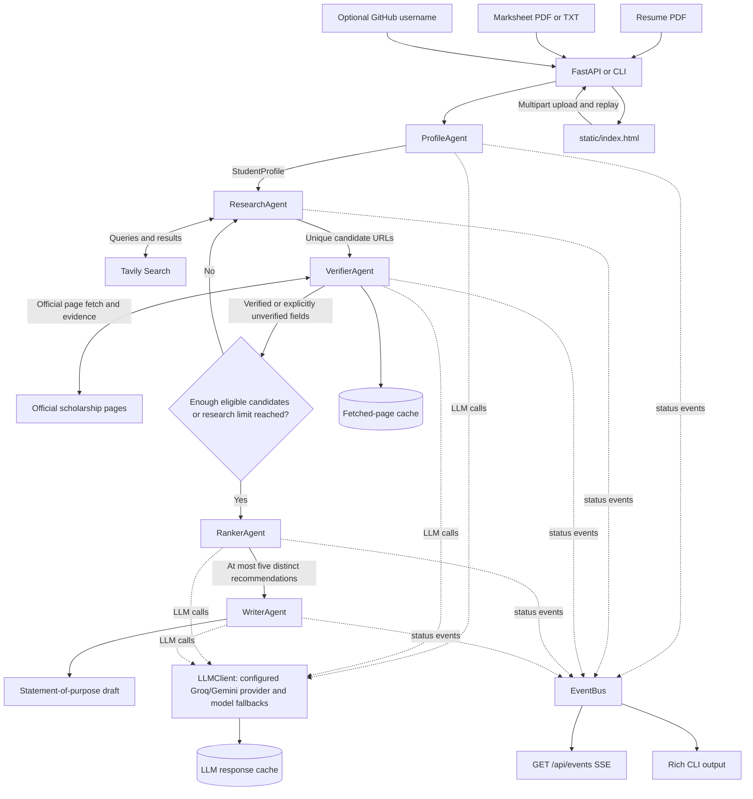

# Scholarship Research Desk

Scholarship Research Desk is a Python 3.11+ project for exploring scholarships and graduate funding from a student resume, marksheet, and optional GitHub username. FastAPI serves a plain HTML/CSS/JavaScript interface and API; LangGraph coordinates the agents; Tavily provides web search when configured; Groq and Gemini can provide LLM calls.

Recommendations are research leads, not admissions decisions. Page evidence is retained with verified fields, uncertain fields stay `unverified`, and application materials are drafts only. The program never submits an application.

## Architecture



`agents/` contains the five agents. The supporting modules (`config.py`, `models.py`, `llm_client.py`, `event_bus.py`, `page_cache.py`, and `startup_check.py`) remain at the repository root because existing imports depend on those paths; no `core/` package move is needed.

## Agent roles and recovery

| Agent | Responsibility |
| --- | --- |
| Profile | Extracts resume and marksheet text, optionally enriches it from a public GitHub profile, and returns a structured student profile. |
| Research | Builds queries from the student's field, target degree, interests, funding need, and target countries; searches Tavily when configured and supplements sparse results from a curated list. |
| Verifier | Fetches candidate pages, follows an official link when it can recover one from an aggregator, and accepts field values only when a fetched-page evidence snippet supports them. |
| Ranker | Excludes recognized third-party, non-official, news/announcement, and closed-cycle results; deduplicates URLs and similar names; ranks up to five candidates. |
| Writer | Produces a statement-of-purpose draft grounded in the available student profile and selected opportunity. |

The LLM client follows the configured `LLM_PROVIDERS` order (Groq and Gemini), including configured model fallbacks. Provider errors such as rate limits can trigger recovery and a provider/model switch; agents have deterministic or explicit unverified fallbacks. Verifier work is bounded to ten candidates per pass and 40 seconds per candidate. A failed or timed-out candidate is retained as unverified and does not stop the other candidates. Fetched pages and LLM responses are cached under ignored `cache/`.

Some facts cannot be confirmed from pages and remain `unverified`; search snippets alone are not verification evidence. Curated fallbacks are not treated as live verification. Official-domain recognition is rule-based and may miss legitimate institutions or sites, so review each linked source. Eligibility and deadlines can change after a run.

Research adapts its search terms and country alignment to extracted profile fields and user-supplied target countries, degree level, funding need, and interests rather than assuming one student. User-supplied preferences override inferred profile values. When a profile has limited matching sources, broader or curated international opportunities can still appear; inspect the country and eligibility evidence before acting. The bundled computer science, mechanical engineering (lower CGPA), and commerce profiles were run offline here: their top fives varied by profile, with some overlap from broad global fallback sources.

The website accepts PDF, TXT, PNG, or JPG resume and marksheet files. PDFs with fewer than 50 extracted characters are retried with `pdfplumber`, then optional `pytesseract`/`pdf2image` OCR when those packages are installed. Unreadable uploads are reported in the profile's **Inputs read** summary rather than silently treated as missing. GitHub accepts a profile URL or username; repository metadata comes from the public GitHub REST API and can be unavailable due to network or rate limits.

## Setup

From the project folder in PowerShell:

```powershell
.\.venv\Scripts\python.exe -m venv .venv
.\.venv\Scripts\python.exe -m pip install -r requirements.txt
Copy-Item .env.example .env
```

Add credentials only to your local `.env`; never commit or share it. Credential names are `GROQ_API_KEY`, `GEMINI_API_KEY`, and `TAVILY_API_KEY`; `GITHUB_TOKEN` is optional. Optional provider/model configuration names are `LLM_PROVIDERS`, `GROQ_MODEL`, `GROQ_MODEL_FALLBACKS`, `GEMINI_MODEL`, and `GEMINI_MODEL_FALLBACKS`. Runtime tuning names are `LLM_CONCURRENCY`, `VERIFIER_CONCURRENCY`, `MAX_LLM_RETRIES`, `MAX_RESEARCH_ROUNDS`, and `REQUEST_TIMEOUT`. Defaults are provided in `config.py`.

## Run the website and API

```powershell
.\.venv\Scripts\python.exe -m uvicorn api:app --port 8000
```

Open <http://localhost:8000>. The main routes are:

| Route | Behavior |
| --- | --- |
| `GET /` | Serves the research desk. |
| `GET /api/health` | Returns `{"live": bool}`; `live` reflects whether an LLM provider answered the startup check. |
| `GET /api/events` | Streams JSON `PipelineEvent` messages through SSE, including `started`, `progress`, `recovery`, `done`, and `error`. The event bus is process-global; streams are not isolated by run. |
| `GET /api/replay` | Returns `samples/demo_result.json`; the page visibly labels it as a replay. |
| `POST /api/find-scholarships` | Accepts `resume`, `marksheet`, optional `github_username`, `target_countries`, `target_degree_level`, `financial_need`, `interests`, and `pick` multipart fields. The response includes character counts, source status, and the submitted preferences in `student_profile.inputs_read`. |

## Run the CLI

```powershell
.\.venv\Scripts\python.exe run_cli.py --resume samples/sample_resume.pdf --marksheet samples/sample_marksheet.pdf --github alexrivera-dev --pick 1
```

`--resume` and `--marksheet` are optional CLI arguments; `--github` is optional. `--pick` selects the ranked item used for the draft, `--output` changes the JSON output path (default `output/result.json`), and `--require-live` exits if startup has no live LLM provider. Use `--save-demo` only after a successful live run if you intend to replace the saved example.

## Tests

```powershell
.\.venv\Scripts\python.exe -m pytest -q
```

Tests cover API routes and event streaming, profile/pipeline behavior, evidence and deadline checks, provider fallback handling, timeouts, ranking, and draft output. Tests may exercise cached or offline paths; a passing test suite does not prove that external API credentials or a live provider are working.

## Limitations and safety

- Live search and LLM checks require configured credentials and remain subject to provider quotas, network errors, and page blocking.
- Heuristic evidence extraction is conservative; some fields will correctly remain `unverified`, and curated fallback candidates are not independently confirmed until fetched-page verification succeeds.
- The ranker returns up to five recommendations when enough distinct candidates pass its checks; it does not promise five.
- Review source pages, deadlines, and eligibility yourself. Generated statements are marked as drafts; the software never submits applications.
- AI coding tools were used to organize, implement, test, and document this project.
