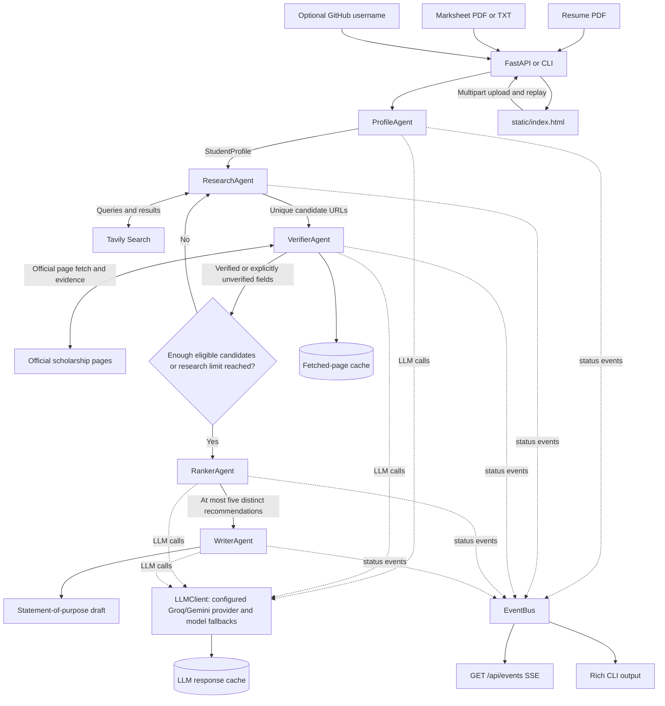

# Architecture

The graph is implemented in `graph.py`; FastAPI and CLI entry points are `api.py` and `run_cli.py`. Supporting modules stay at the repository root to preserve their existing import paths.
